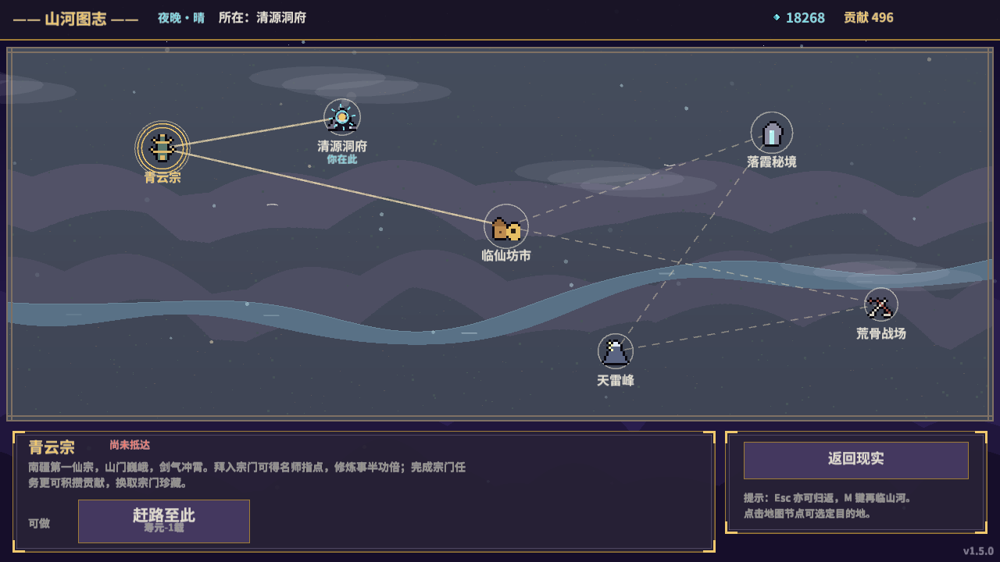

# 《凡人修仙·轮回模拟器》v1.5.0 实现报告（含 TapTap H5 首包）

- 版本：v1.5.0（`Cargo.toml:3` `version = "1.5.0"`，与 `web/index.html:77` `GAME_VER="1.5.0"` 缓存穿透号同步）
- 报告日期：2026-10-11
- 基线：v1.4.0（大地图版本）之上迭代；**本次未做任何 git 提交**（`git status` 仅有工作区改动，发布提交由主对话统一负责）
- 证据约定：文中「代码」均给出 `文件:行号`（本轮逐一打开核对）；「实测」指本报告撰写轮亲自执行的命令与输出；「流水线实测」指本次开发流水线各 ask 中执行并留有记录的验证，撰写轮未重复执行的会如实标注。

---

## 一、功能清单（v1.5.0 玩法特性）

以下每条均对照代码与本轮冒烟截图（`shots/shot_000~041.png`，共 42 张）确认。

### 1. 洞府经营（清源洞府三大设施）
- 数值表：`src/data.rs:1794-1805` —— `DONGFU_FACS=["聚灵阵","灵田","丹房"]`、`JUELING_MULT=[1.00,1.15,1.30,1.50]`、`LINGTIAN_YIELD=[0,300,1200,5000]`、`DANFANG_DISC=[1.00,0.90,0.80,0.70]`、升级费用 `DONGFU_UP_STONES=[2000,20000,200000]` + `DONGFU_UP_CONTRIB=[30,120,400]`。
- 逻辑：升级 `src/world.rs:449` `dongfu_up`；聚灵阵与天气收益接入闭关 `src/game.rs:3686`（「聚灵阵层级 + 天气×所在地收益」）；丹房折扣接入药价 `src/game.rs:4423,4441`（`pill_price` 乘 `DANFANG_DISC[...]`）。
- 入口：清源洞府节点新增「经营洞府」按钮与经营覆盖层（`src/world.rs:814,833`；左栏摘要 `src/draw.rs:588`）；洞府节点描述同步改写（`src/data.rs:1558` 起 `LOCATIONS[3]` desc/acts）。
- 截图证据：shot_036~038 经营覆盖层；升级数值自洽——聚灵阵 1→2 级灵石 21.8万→19.8万、贡献 996→876，灵田 1→2 级灵石 17.8万、贡献 756，灵石不足 20 万时升 3 级按钮正确置灰（流水线终局验收逐张目检）；本轮复核 shot_028 总览页「洞府：聚灵阵1 · 灵田1 · 丹房0」。

### 2. 四时昼夜·天气系统
- 数值表：`src/data.rs:1731-1775` —— 4 时段 `SLOTS=["清晨","白昼","黄昏","夜晚"]` 与 `SLOT_TINT` 叠色、5 种天气 `WEATHERS=["晴","云","雨","雾","灵潮"]` 与 `WEATHER_TINT`、5×5 转移矩阵 `WEATHER_TRANS`、6 地点收益倍率表 `WEATHER_LOC_MULT` 及 `weather_loc_mult()`（`src/data.rs:1772`）。
- 推时辰口唯一化：现实闭关推岁与地图推岁统一走 `advance_time`（`src/game.rs:3803`）；地图侧死亡判定后才调 `g.advance_time()`，死亡当年不推时辰不产灵田（`src/world.rs:74-89` `spend_year`）。
- 收益接入：宗门任务收益×天气地点倍率（`src/world.rs:154,160`）、秘境远征抉择倍率（`src/world.rs:326`）、闭关效率两行（`src/game.rs:3686`）。
- 表现：山河图志整幅时段/天气叠色（`src/world.rs:527-533`）、水面波光 5 点（`src/world.rs:538-541`，复用 `src/art.rs:295` `map_river_y`）、飞鸟 3 只（`src/world.rs:552`）、洞府炊烟（`src/world.rs:560`）、路线高亮、顶栏「时段·天气」（`src/world.rs:508` `draw_world`）。
- 截图证据：本轮目检 shot_031~041 段顶栏依次出现 夜晚·雨→清晨·雨→黄昏·晴→夜晚·晴→清晨·云→白昼·晴→黄昏·雨 共 7 种组合，夜色暗蓝/黄昏暖棕叠色肉眼可辨（流水线终局验收 42 张逐张看完；本轮亲检 shot_033「清晨·雨」、shot_034「黄昏·晴」、shot_035「夜晚·晴」、shot_039「清晨·云」四张）。

### 3. 法宝装备位（8 件法宝至多佩戴 3 件）
- 数值：`src/data.rs:1790-1791` —— `RELIC_EQUIP_MAX=3`、`RELIC_UNEQUIP_FRAC=0.3`。
- 逻辑：装备/卸下 `src/game.rs:3760,3784`（卸下不消失，仍按三成灵性计，`src/game.rs:3783` 注释）；修炼与战力系数均按装备态计算——已装备全额生效、未装备按三成（`src/game.rs:671-679` `relic_cult`、`src/game.rs:793-799` power）。
- 模拟镜像守则：文件头 `src/game.rs:9` 新增守则注释「任何克隆/构造模拟 Life 的地方必须同步 `equipped = relics.clone()`」；`launch_sim` 克隆后同步 `src/game.rs:1222`；模拟中获得法宝的 6 处获得点逐站点同步 `equipped.push`（流水线逐点接线，`src/game.rs:8` 注释说明违反后果）。
- 截图证据：shot_029 法宝页——左 3 装备槽（已装青竹蜂云剑+「卸下」按钮）、右 8 行法宝列表点击装备、底部「已装 1/3；未装备的法宝保有 30% 灵性」；行囊中装备态法宝有颜色标记（`src/draw.rs` 零几何改色）；总览页显示「法宝：已装 1/3 · 包内 2」摘要（shot_028，本轮亲检）。

### 4. 角色面板 v2：三页签（总览 / 法宝 / 成就·称号）
- 结构：`src/charpanel.rs:1`（文件头说明）、页签状态 `g.char_tab`（`src/game.rs:530`，Game::new 初始化 0 见 `src/game.rs:883`）；×/Esc 关面板同时归零页签（`src/charpanel.rs:19`，`src/main.rs:68` 与 Esc 行为一致）。
- 总览页：立绘 + 所在/宗门/贡献/洞府设施行 + 法宝计数摘要（`src/charpanel.rs:150`「只留计数摘要，装备详情见法宝页」）+ 右栏宿敌/道侣/成就/生涯。
- 法宝页：左 3 槽点击卸下、右 8 行点击装备，手动命中测试（`src/charpanel.rs:275,512` 使用 `cam::mouse()`）。
- 成就·称号页：30 项成就带实时进度（`src/game.rs:3851` `ach_progress`），如「战力通天 49/10亿」；右侧 17 格称号——「自动跟随（佩戴中）」+ 15 档境界称号 + 弑神者，格位映射共用 `title_cell`（`src/charpanel.rs:411`），与 `src/data.rs:1491` `realm_title` 15 档一致。
- 称号佩戴：`src/game.rs:3732,3741` `worn_title_of`/`set_worn_title`（值域 {-1, 0..=14, 15}）；主界面左侧标题接佩戴称号（`src/draw.rs` render_left）。
- 截图证据：shot_027~030 面板巡检段（冒烟序列 `src/main.rs:127-135`，seq=[1,1,2,3,5,5,5] + char_tab 28/29/30→总览/法宝/成就称号，帮助页让位）；本轮亲检 shot_028（总览）、shot_030（成就·称号页 2×15 进度条 + 17 格称号布局完整）。

### 5. 修士立绘四档（凡人/道基/紫府/真仙）
- 数值：`src/data.rs:1777-1779` `PORTRAIT_TIERS=[0,3,6,10]` 各档境界下限 + `portrait_tier()`。
- 美术：`src/art.rs:54` `build_portrait(tier)` 四档程序化立绘（金冠/霜鬓/白发），`Art` 结构新增 `portraits[4]`；`src/art.rs:507` `draw_cultivator` 加 tier 参——tier≥2 背光+光点、≥3 仙环；`src/draw.rs` 4 处调用传 tier。
- 覆盖说明：冒烟轮 best_realm 未达档位 6/10，tier2/3 立绘仅代码核验、未目检截图（见「遗留问题」）。

### 6. 信箱相机 `src/cam.rs`（新增模块，H5 适配打底）
- `src/cam.rs:11` `view_cam()` 信箱相机：`dw=sw/fit、dh=sh/fit` 显式等比适配任意屏比例；`src/cam.rs:30` `mouse()` 屏幕坐标→世界坐标换算。
- 接线：`src/main.rs` set_camera/7 分支场景/set_default_camera；`src/draw.rs:23,915,1270`、`src/charpanel.rs:275,512`、`src/world.rs:670` 共 6 处 `mouse_position` 改 `cam::mouse()`。
- 效果：桌面 1280×720 显示恒等（本轮 6 张截图均为标准 1280×720 构图，无裁切/拉伸）。

### 7. 存档桥与迁移（桌面 / 浏览器双端）
- 双端后端：`src/save.rs:17-47` `#[cfg(target_arch="wasm32")] mod backend`（导出 `xx_storage()` 供插件版本核对 + `xx_save_len/xx_save_read/xx_save_write` 三个 env 导入，长度一律 UTF-8 字节数）；`src/save.rs:49` 起 `#[cfg(not(wasm32))]` 走 std::fs 原样；`src/save.rs:14` `STORAGE_KEY="xiuxian_save"`。
- 新存档键：`Lequip`（装备位）、`Lslot`（clamp 0-3）、`Lweather`（clamp 0-4）、`wtitle`（缺省 -1）、`df`（clamp 0-3）——写出 `src/save.rs:114-116`，解析 `src/save.rs:236-243` 与 `wtitle`/`df` 缺省分支。
- 迁移（顺序不可变，`src/save.rs:278-301`）：先清 relics（越界剔除+保序去重）→ 缺 `Lequip` 则默认装备包内前 3 件（与 v1.4 全量生效行为最接近，显式 `[]` 则尊重卸光）→ 再清 equipped（⊆relics、去重、`truncate(3)`）；`wtitle` 越域回退 -1。
- 回归单测 4 个（`src/save.rs:312-346`）：`old_save_migrates_equipped_first3` / `explicit_empty_equip_respected` / `out_of_range_keys_clamped` / `relics_sanitized_and_title15_kept`——本轮 `cargo test` 4/4 通过。

### 8. 冒烟与净版基建
- GF_CLEAN 净版：读档前删档 + 水印开关（`src/main.rs:29-31`，修复了首版「先画后删」顺序缺陷）；版本水印条件化——仅 `GF_DEBUG=1` 且未设 `GF_CLEAN=1` 时绘制，OnceLock 求值一次（`src/draw.rs:361-375`）；H5/正式包两变量都不设则不画。
- 冒烟扩容：GF_DEBUG 截图上限 40→42（`src/main.rs:114,119`），新增 World 段 shots 32 起（选宗/赶路/拜入+任务/赶路洞府/开经营/升聚灵阵/升灵田/收起/赶路秘境/远征两步，`src/main.rs:223-252`）；两处「冒烟专用」资源补贴已注释标明（发法宝 `src/main.rs:137` 附近、洞府补贴 `src/main.rs:243-247`），正式玩法不由此入账。
- 远征出口：`src/world.rs:62,905` 「远征未竟，不可中途离场」else-if 分支（提示让位于远征面板）。

### 9. 字体子集扩容
- v1.5.0 新增中文文案后重跑字体管线：`assets/font.ttf` 由 390,724 B 扩至 414,556 B（git diff 实测 Bin 变更）。
- 覆盖实测（本轮亲自运行）：`python tools/font_cover_scan.py` → 输出「src/*.rs 非注释 CJK 用字 1122 种；assets/font.ttf 缺 0 个」。此前开发中段曾实测 76 字缺字，现已清零。

---

## 二、H5 / TapTap 交付物清单

### 2.1 `web/`（浏览器运行目录）
| 文件 | 大小/MD5（本轮实测） | 说明 |
|---|---|---|
| `web/index.html` | 12,166 B / `af2899d4…` | 照 GetFish 已验证模板改造：标题/描述/favicon(☯)/加载文案换本游戏；`GAME_VER="1.5.0"`（`web/index.html:77`）缓存穿透（bundle 与 wasm URL 均带 `?v=1.5.0`，`web/index.html:78,181`）；`load()` 前注册 `miniquad_add_plugin(name:"xx_storage")`（`web/index.html:84` 起，TextEncoder/TextDecoder UTF-8 字节协议，localStorage 键 `xiuxian_save`，getItem/setItem 均 try/catch）；保留 file:// 检测/errlog/聚焦/contextlost reload/12s 看门狗/首帧轮询/orientFix；按方案剔除字形图集封顶补丁（本工程 high_dpi:false，首包不需要） |
| `web/mq_js_bundle.js` | 37,407 B / `cc216984…` | 取自 registry macroquad-0.4.16，与 GetFish web/ 实测一致 |
| `web/xiuxian.wasm` | 1,469,395 B / `1454db54…` | wasm32 release 产物（含 `xx_storage` 导出，本轮 grep 二进制实锤） |

### 2.2 `build_web.bat`（一键构建+部署+重打包，新增）
- 流程：`RUSTFLAGS=-C link-arg=--import-undefined` → `cargo build --release --target wasm32-unknown-unknown` → wasm 双路复制到 `web/` 与 `taptap/taptap_verify/taptap_h5/` → 三件套存在性断言 → Python zipfile 重打包 `taptap/taptap_verify.zip`（本轮实读全文确认）。
- 重要约定：**纯 ASCII + CRLF**——实测 cp936 控制台下 UTF-8 中文 bat 会因 GBK 双字节错位吞换行导致命令劈裂（GetFish 式写法报 `'ndefined'/'2-unknown-unknown'` 实锤），ASCII 化后任意代码页可运行。后续勿往该 bat 添加中文。

### 2.3 `taptap/`（上架材料包）
| 文件 | 说明 |
|---|---|
| `taptap/taptap_verify.zip` | **恰 3 条目**：`taptap_h5/index.html`(12,166B) / `taptap_h5/mq_js_bundle.js`(37,407B) / `taptap_h5/xiuxian.wasm`(1,469,395B)；`/` 分隔、根层仅一层 `taptap_h5/`、无反斜杠条目（本轮 `python tools/verify_taptap_zip.py` + `python tools/accept_zip_check.py` 双脚本实测 OK） |
| `taptap/taptap_verify/taptap_h5/` 三件套 | 与 web/ 三文件逐一 md5 相同（本轮实测：html `af2899d4`、bundle `cc216984`、wasm `1454db54`） |
| `taptap/TapTap上传文案.md` | 基础资料/合规声明/推荐语/简介/特色/操作说明/版本说明/标签/素材清单/版权备注；单机免登录、免费无内购、进度仅存设备本地 localStorage 等表述与实际一致（本轮实读目录结构核对） |
| `taptap/发布说明.md` | 对外首包 1.5.0 一次性覆盖内部 v1.0.0~v1.5.0；H5 存档限制、真机首测项、发版流程（本轮实读头部确认） |
| `taptap/promo_1920x1080.png`、`taptap/icon_512.png` | `tools/make_promo_icon.py` 生成：宣传图（山河图志景带+assets/font.ttf 金字游戏名）、图标（主菜单打坐修士立绘光栅化 512²） |
| `taptap/实机截图_H5/01~07` | 主菜单/天赋抽取/现实闭关/山河图志/角色面板/洞府经营/秘境远征 7 张，1280×720，取自 GF_CLEAN 净版冒烟（流水线逐张目检无水印无调试信息） |

### 2.4 配套工具（`tools/`，新增）
`verify_taptap_zip.py`（ZIP 结构断言）、`accept_zip_check.py`（三件套+插件函数+缓存穿透号全量核验，本轮实跑全绿：`xx_save_len/xx_save_read/xx_save_write/miniquad_add_plugin/xx_storage/TextEncoder/TextDecoder/localStorage/xiuxian_save` 全部 FOUND、`GAME_VER=1.5.0`、zip 内 wasm 与磁盘 md5 same=True）、`make_promo_icon.py`、`font_cover_scan.py`、`contact_sheet.py`、`smoke_font_check.py`。

### 2.5 wasm 构建结论
- `cargo check` 零错误（本轮实测）；wasm 交叉构建 `RUSTFLAGS=-C link-arg=--import-undefined cargo build --release --target wasm32-unknown-unknown` 通过、`cmd //c build_web.bat` 全链路成功（流水线实测；本轮以三处产物 md5 一致 + `xx_storage` 导出存在佐证产物在位）。
- 桌面回验：GF_DEBUG 冒烟 exit=0、42 张、水印正常（流水线实测）。
- `cargo test` 4/4（本轮实测）。

> 注：素材摘要中记载的 wasm 旧 md5 `cd04de48…` 已过期——终局验收前曾为自动驾驶补秘境截图腿（GF_DEBUG 专用路径+上限 40→42）并重建双端，**当前三处 wasm md5 一致为 `1454db54…`（1,469,395 B），本轮实测为准**。

---

## 三、改动文件清单（git 实测：12 改 + 新增若干）

**修改（`git status` M，`git diff --stat HEAD`）：**
| 文件 | 变更量 | 要点 |
|---|---|---|
| `Cargo.toml` / `Cargo.lock` | 2 行 | 版本 1.5.0 |
| `README.md` | 3 行 | 版本说明随动 |
| `assets/font.ttf` | 390,724→414,556 B | 字体子集扩容，缺字清零 |
| `src/data.rs` | +83/-x | 时段/天气/立绘档/装备上限/洞府数值表 + LOCATIONS[3] 改写（§一.1/2/3/5） |
| `src/game.rs` | +247/-x | Life+equipped/slot/weather、Meta+worn_title/dongfu[3]、char_tab；launch_sim 镜像同步与 6 处获得点同步；装备态系数；advance_time/equip_relic/unequip_relic/worn_title_of/set_worn_title/ach_progress；丹房折扣；守则注释（`src/game.rs:9`） |
| `src/save.rs` | +170/-x | 双端 backend、5 新键、迁移清洗、parse_save 抽纯函数 + 4 单测 |
| `src/main.rs` | +85/-x | mod cam、GF_CLEAN 删档（读档前）、相机接线、Esc 归零 char_tab、面板巡检 seq+char_tab、World 段 shots 32+、上限 42 |
| `src/draw.rs` | +52/-x | version_mark 条件化（OnceLock）、佩戴称号标题、法宝计数摘要、装备态颜色标记、3 处 cam::mouse、4 处 draw_cultivator 传 tier |
| `src/art.rs` | +90/-x | map_river_y 抽 pub、build_portrait 四档、portraits[4]、draw_cultivator tier |
| `src/charpanel.rs` | +357/-x | 重写为三页签（总览/法宝/成就·称号），title_cell 17 格映射，手动命中 cam::mouse |
| `src/world.rs` | +234/-x | WorldState+dev、spend_year 推岁口唯一化、任务/远征天气倍率、dongfu_up、draw_world 叠色/波光/飞鸟/炊烟/路线高亮/经营覆盖层、gate 补 !dev、远征提示 else-if |

**新增（git 未跟踪）：** `src/cam.rs`、`build_web.bat`、`web/`（index.html + mq_js_bundle.js + xiuxian.wasm）、`taptap/`（ZIP、三件套、两份文档、宣传图、图标、7 张实机截图）、`tools/`（verify_taptap_zip.py、accept_zip_check.py、make_promo_icon.py、font_cover_scan.py、contact_sheet.py、smoke_font_check.py）。

开发期流水线口径「10 改 1 增」指玩法阶段 src+Cargo 主体（cam.rs 为 1 增）；上表为 git 全量口径，两者不矛盾。

---

## 四、设计与平衡要点

1. **装备三成灵性**：佩戴位把「收法宝」从纯计数变为构筑取舍——3 槽上限 + 未装备 30% 灵性（`src/data.rs:1790-1791`），旧档迁移取前 3 件使默认行为与 v1.4 全量生效最接近（`src/save.rs:287-294` 注释言明此意图）。
2. **四时经济**：聚灵阵闭关倍率最高 ×1.5、灵田产出随天气起伏、丹房最低七折，升级需灵石+宗门贡献双货币（洞府玩法与宗门线互相勾连）；天气×地点倍率让「去哪、何时去」成为决策（灵潮时段灵机暴涨）。
3. **推岁口唯一化**：`advance_time` 只在 `act_cultivate` 与 `spend_year` 两处入口被调，且死亡当年不推时辰——避免多入口推时辰导致时段漂移不可复现（`src/world.rs:87` 注释）。
4. **模拟侧镜像守则**：`equipped` 是 `relics` 的设备态镜像，文件头守则（`src/game.rs:8-9`）明确「克隆必同步、获得必 push」，否则法宝在模拟内只按 30% 计且与面板显示不一致——这是 v1.5.0 最容易回归的坑。
5. **存档只增不改**：新键全部缺失给默认值，`parse_save` 抽纯函数使迁移规则可用 4 个单测锁定；wasm 侧与桌面同格式同键，天然兼容。
6. **发布画面卫生**：版本水印仅在调试冒烟出现（`src/draw.rs:362-365` 注释「H5/正式包两个环境变量都不设不画」）；GF_CLEAN 同时保证净版从新档开始。
7. **相机先行**：cam.rs 在桌面恒等（本轮截图无畸变佐证），为 H5 任意屏比例（含 390×844 竖持）适配打底，后续无需再改业务层取坐标。

---

## 五、验证情况

### 本轮（报告撰写轮）亲自执行
| 检查 | 命令 | 结果 |
|---|---|---|
| 编译门 | `cargo check` | 0 error（5 条 dead-code 类 warning） |
| 测试门 | `cargo test` | **4 passed; 0 failed**（save 迁移 4 单测） |
| ZIP 结构 | `python tools/verify_taptap_zip.py` | OK：3 条目齐全、`/` 分隔、根层仅一层、wasm 含 xx_storage、index.html 含 ?v=1.5.0 与存档插件 |
| ZIP 全量核验 | `python tools/accept_zip_check.py` | 全绿：TRI×3 OK、html zip/web md5 identical、缓存穿透 `mq_js_bundle.js?v=1.5.0`、9 项插件函数 FOUND、GAME_VER=1.5.0、wasm zip=磁盘 md5 same=True |
| 产物一致性 | `md5sum` 三处 wasm/bundle/html | 三处两两一致（wasm `1454db54`/1,469,395B，bundle `cc216984`，html `af2899d4`）；wasm 二进制 grep 到 `xx_storage` 导出 |
| 字体覆盖 | `python tools/font_cover_scan.py` | 1122 种 CJK，缺 0 |
| 版本号 | 读 `Cargo.toml:3`、`web/index.html:77` | 双处 1.5.0 同步 |
| 截图目检 | Read 检视 shot_028/030/033/034/035/039 | 面板三页签与地图昼夜天气全部与描述相符；6 张右下角均见 v1.5.0 水印（冒烟模式应显示） |
| 交付物清点 | `ls/find taptap web docs shots` | 42 张冒烟图、7 张 H5 实机截图、3 件套×2、ZIP、2 文档、宣传图/图标均在位 |

### 流水线各 ask 已执行（撰写轮未重复跑，如实标注）
- `cmd //c build_web.bat` 全链路（构建+双路复制+三件套断言+ZIP 重打包）成功；wasm 交叉构建通过（流水线实测）。
- HTTP 验证：`taptap/taptap_verify/` 下 `python -m http.server 8124`，curl 实测 index.html / mq_js_bundle.js / xiuxian.wasm 均 200 且体积一致，带 `?v=1.5.0` 亦 200；验证后已关服务（流水线实测）。
- 桌面冒烟：`rm -f shots/*.png` + `GF_DEBUG=1 ./target/release/xiuxian.exe`（16:24 release 构建）exit=0，42 张；流水线终局验收逐张目检：42/42 张右下角 v1.5.0 水印、地图 7 种时段天气组合、面板三页签、洞府升级数值自洽、远征链与「远征未竟」出口、其余画面无回归。
- 净版：GF_CLEAN=1 GF_DEBUG=1 实跑 exit=0、42 张，水印关闭、删档生效（流水线实测）。
- 旧档读回：4 单测 + 多轮冒烟实证（迁移规则见 §一.7）。

### 门控结论
- 第 1 轮门控 `cargo check` 与 `cargo test` 全绿（流水线实测），撰写轮复跑仍全绿（见上表）。
- 终局验收：**通过**（桌面画面逐张核验 + TapTap 包结构与内容核验）。

---

## 六、遗留问题与建议

### 已知遗留（按影响排序）
1. **H5 真机/浏览器实测未做**：index.html 系 GetFish 已验证模板平移，但本游戏未在真机 WebView/浏览器实际运行过；wasm 下 std::fs（GF_DEBUG 建目录、GF_CLEAN 删档）编译通过、运行时应为空操作，符合预期但未在浏览器逐项确认。
2. **冒烟未覆盖的路径**：称号格点击装备/拒绝路径（仅视觉+代码核验 `src/charpanel.rs:411`）；远征抉择已冒烟（shots 40/41）但天气倍率数值未单独断言；立绘 tier2/3（best_realm 未达 6/10，无截图证据）。
3. **装备量级对拍未做定量基线**：launch_sim 镜像同步（必修2）仅做「带宝模拟无异常 + 公式核验」（`src/game.rs:671-679,793-799`），未与 v1.4 数值做定量对比。
4. **成就 #18 描述与判定不符（历史遗留，原样保留）**：`src/data.rs:1362` desc「剑心通明+结丹」与实际检查（neme_slain）不符；`ach_progress(18)` 按实际检查显示进度（面板显示「剑仙之姿 0/1」），建议后续版本统一文案。
5. **洞府升级冒烟依赖资源补贴**：autopilot 直调补贴已注释标明（`src/main.rs:243-247`「冒烟专用」），真实经济下从零攒到 20 万灵石的节奏未在冒烟中体验，属设计手感问题非缺陷。

### 真机首测项（TapTap 上架前建议逐项过）
- [ ] localStorage 存档：首玩写入→刷新/杀进程重进读回；旧桌面档手工灌入 localStorage 能否读回（迁移规则实测）
- [ ] 390×844 竖持与安卓/iOS WebView 横竖屏切换（cam.rs 信箱适配 + orientFix 生效）
- [ ] 触屏交互：地图节点点击/面板按钮/三页签切换（cam::mouse 换算在非 1280×720 视口下）
- [ ] 加载链路：12s 看门狗、contextlost 自动 reload、file:// 诊断文案
- [ ] 音频可用性（BGM/音效在 WebView 解码）
- [ ] 缓存穿透：发新版后旧 WebView 不复用上一版 wasm

### 工程建议
- 发版时 `Cargo.toml` 版本与 `web/index.html` `GAME_VER` 必须同升（发布说明.md 已立此规）。
- `build_web.bat` 保持 ASCII+CRLF，勿添加中文（cp936 劈裂实锤）。
- 下次大版本建议补：装备前后战力定量对拍脚本、立绘 tier2/3 冒烟强推档位、成就 #18 文案修正。

---

## 七、报告配图

*图：山河图志「夜晚·晴」（shots/shot_035.png）——整幅夜色叠色、顶栏时段·天气、路线高亮与「你在此」标记，当前位于清源洞府。*

*图：角色面板 v2 总览页（shots/shot_028.png）——总览/法宝/成就·称号三页签；左栏立绘与所在清源洞府/宗门/贡献 468/洞府「聚灵阵1·灵田1·丹房0」；中部法宝「已装 1/3 · 包内 2」；右栏宿敌/道侣/成就 1/30/生涯。*

- `docs/map.png` ← `shots/shot_035.png`（179,614 B）：候选中夜色叠色最强、时段·天气信息最清晰、且无覆盖层遮挡的地图帧（对比本轮亲检的 shot_033 清晨·雨、shot_034 黄昏·晴、shot_039 清晨·云）。
- `docs/panel.png` ← `shots/shot_028.png`（284,108 B）：总览页一屏同时呈现三页签、立绘、洞府设施行、法宝计数摘要与右栏生涯栏，信息密度最高（替代旧 v1.4.0 版本的两张配图，已覆盖）。
